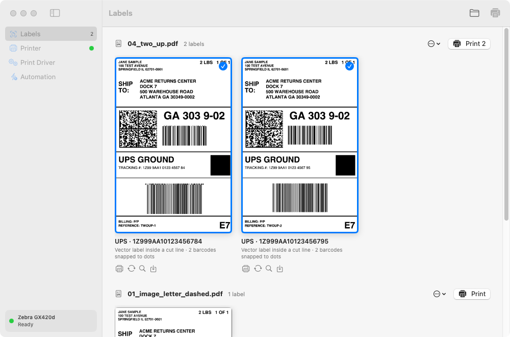
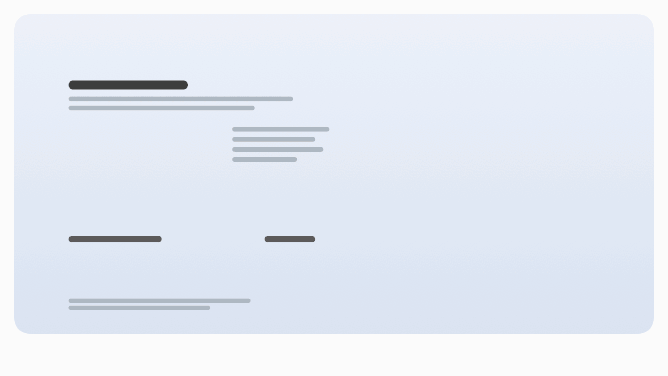
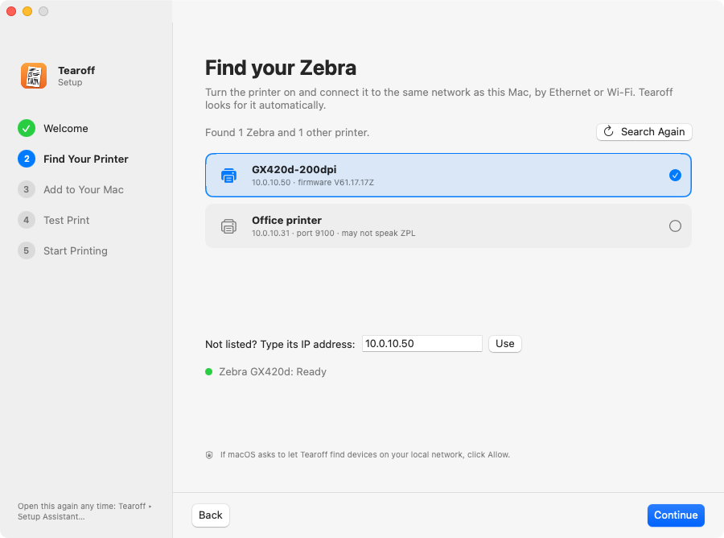
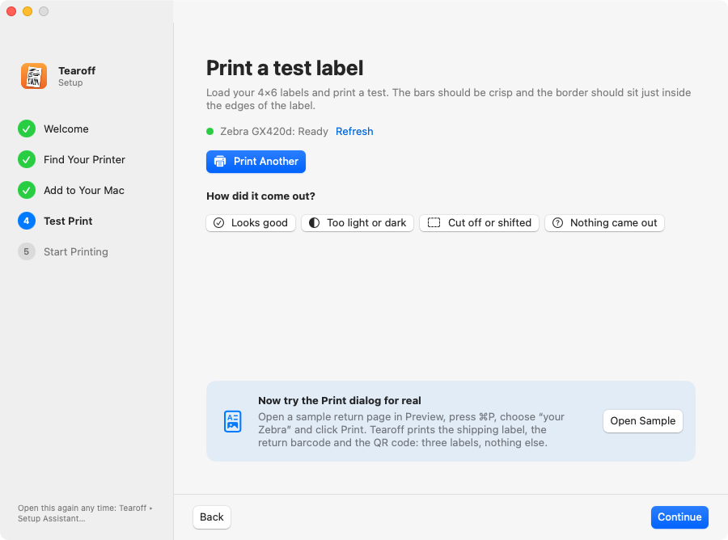
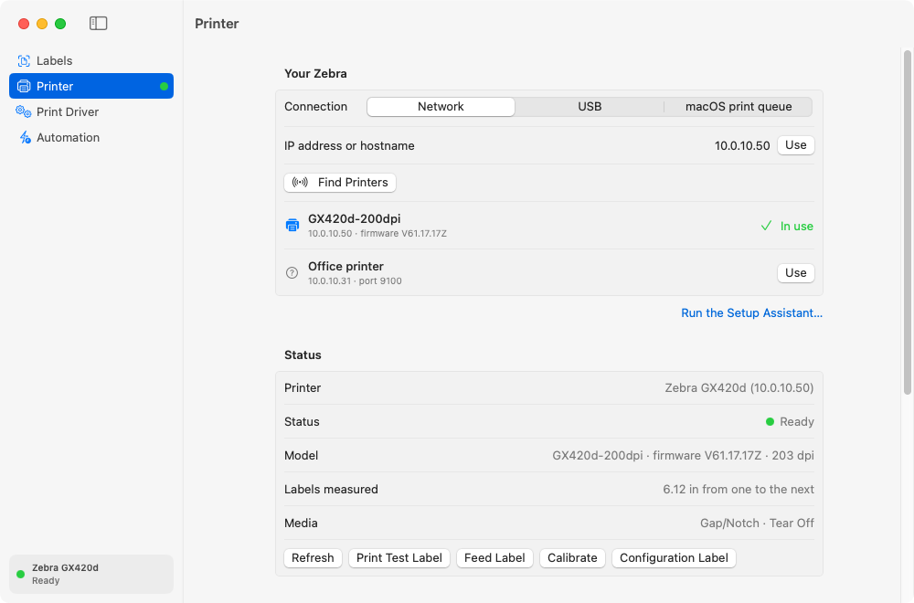
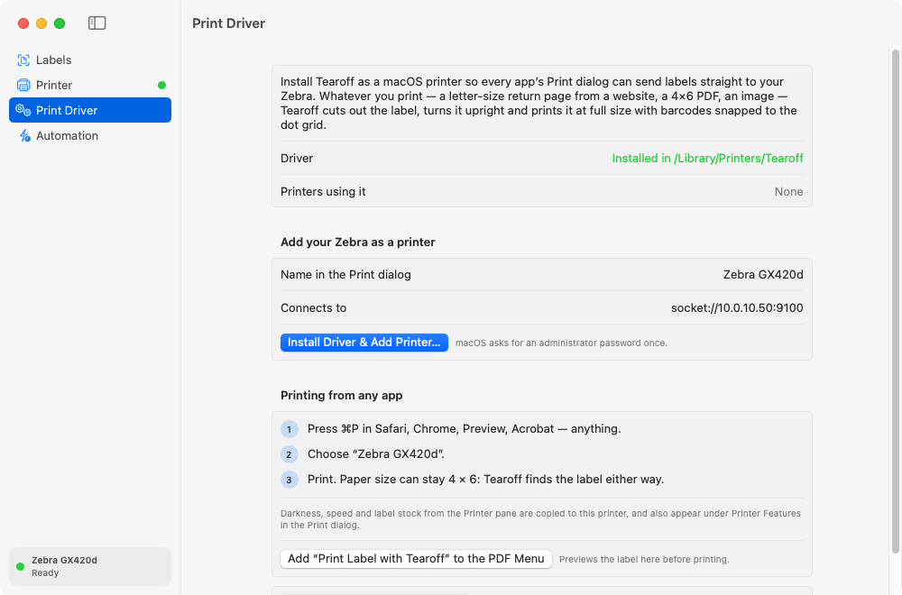

<p align="center"></p>

# Tearoff: crisp Zebra labels from any Mac app

Tearoff is a native macOS printer driver and app for Zebra ZPL label printers (GX420d, GK420d, ZD420/421, ZP 450/500…),
on your network or plugged in by USB.
Print a shipping label from **any** app with ⌘P and get a full-size, upright 4×6 label with every barcode
snapped to the printer's dot grid. That includes labels sitting on a letter-size web page, labels lying on their side, and two labels per sheet.

<p align="center"></p>

## What it does

- **A real macOS printer driver.** Your Zebra shows up in every Print dialog. Tearoff's CUPS filter finds the
  label on whatever an app prints and sends it as one compressed ZPL graphic. The label comes out in one pass, with no pausing mid-label.
- **Finds the label for you.**
  - **Embedded images** (UPS/FedEx/Amazon returns) are read at their *native* resolution straight from the PDF.
    This holds even when the browser squashed them, as Firefox does.
  - **Vector labels**, framed or unframed, with solid or dashed cut lines, upright or sideways, are cut out of the page.
    Tearoff never needs a separate image for them.
  - **Two-up sheets** become two labels. **4×6 pages** print 1:1. Pages a browser shrank onto 4×6 paper are scaled back up from the original vector or image data, so nothing goes soft.
- **Prints the other codes too.** A barcode or QR code outside the shipping label, such as Amazon's *Return Authorization Slip*,
  a drop-off QR code or an order barcode, prints on a label of its own after the shipping label. Each one includes the text
  printed beside it, is scaled as large as the stock allows, and lies on its side when that makes it bigger. Turn it off under
  *Printer → Also print other barcodes and QR codes*, in the Print dialog's *Printer Features*, or with `--no-extras`.
- **Turns labels upright** by reading the Code 128 start/stop patterns. This works for raster labels with no text layer.
- **Grid-fit barcodes.** Every Code 128 symbol is decoded and its checksum verified, then redrawn so each bar and space is a
  whole number of printer dots (e.g. 16-mil modules → exactly 3 dots at 203 dpi). A barcode whose checksum doesn't verify is
  never redrawn. QR codes on their own label are sampled module by module and redrawn with even, whole-dot modules.
- **Clean text from low-resolution labels.** Browsers often save the label as a small on-screen copy (around 96 dpi). Tearoff
  rebuilds its edges at print size instead of copying pixels into blocks, so small text stays legible and thin strokes stay
  whole. The text printed with a slip's barcode is retyped crisply from the barcode's own value, but only after on-device OCR
  confirms the printed line says exactly that. Nothing about the shipping label's own text is guessed or retyped.
- **Drop a PDF on the app** to preview exactly what the printer will get, dot for dot, then press Return to print.
- **Watch Downloads**: a new label PDF pops a notification with a Print button, or prints automatically.
- **Printer tools**: USB and LAN discovery (port 9100 + the printer's web page; nothing that could print is ever sent to an
  unknown device), live status (paper out, head open, paused on the network; plugged in or not on USB), test label, calibrate,
  darkness, speed, offsets.
- **`tearoff` command** for scripts: `tearoff print label.pdf`.

| | Tearoff | CrispDock |
|---|---|---|
| Price | Free, open source (MIT) | Free tier watermarks every label; Pro $29.99/yr or $79 |
| Driver for ⌘P in any app | ✓ | ✓ |
| Letter-sheet / sideways / two-up labels | ✓ | ✓ |
| Native-resolution embedded images, vector labels without frames | ✓ documented | not described |
| Barcodes redrawn on the dot grid, verified by checksum | ✓ | "mapped to the dot grid" |
| Watch Downloads, auto-print | ✓ | — |
| Command-line tool | ✓ | — |
| Activation / internet check | none | required |

## Install

Paste this into Terminal. It downloads the installer and opens it, with no Gatekeeper warning:

```bash
curl -fsSL https://raw.githubusercontent.com/au12/Tearoff/main/get.sh | bash
```

Or **[download Tearoff.pkg](https://github.com/au12/Tearoff/releases/download/latest/Tearoff.pkg)** in a browser. Tearoff isn't
signed by a paid Apple Developer account, so macOS will say *"Tearoff.pkg" Not Opened*. Click **Done**, open **System Settings →
Privacy & Security**, scroll down, click **Open Anyway** next to Tearoff.pkg, and confirm. You only do this once. Everything the
installer puts on your Mac then runs without warnings.

<p align="center"></p>

The installer puts Tearoff in /Applications and `tearoff` in /usr/local/bin. Two optional parts are on by default: the **Zebra
printer driver** (/Library/Printers/Tearoff) and the **Print Label with Tearoff** item in every Print dialog's PDF menu. When it
finishes, Tearoff opens. Requires macOS 13 or later, on an Apple Silicon or Intel Mac.

Building from source: `./install.sh` (Xcode or the Command Line Tools) builds the same package and opens it.

## Set up (once)

When the installer finishes, Tearoff opens its **Setup Assistant**. It takes about a minute:

1. **Find your printer.** Tearoff looks for Zebras plugged into the Mac by USB and on your network, and lists Zebras first.
   A single Zebra is picked for you, or you can type a network printer's IP address. macOS asks once to allow local network
   access; click Allow.
2. **Add it to your Mac.** One click adds e.g. "Zebra GX420d" to the Mac's printers, connected straight to the printer
   (`socket://IP:9100`, or its USB port), so it's in the Print dialog of every app. Usually no password is needed.
3. **Test print.** Print a test label, then answer *How did it come out?* Each answer has a fix: darkness for too light or too
   dark, calibrating and label stock for cut-off or shifted labels, and troubleshooting when nothing printed. **Open Sample**
   opens a sample return page in Preview, so you can try ⌘P for real. It prints the label, the return barcode and the QR code.
4. **Start printing.** An animation shows the whole idea:

<p align="center"></p>

<p align="center">
  
  
</p>

Open it again any time from **Tearoff ▸ Setup Assistant…**, the menu bar icon, or the Printer pane. Everything it sets is also in
the main window:

<p align="center">
  
  
</p>

## Print

- **From any app:** ⌘P → choose your Zebra → Print. Leave the paper size at 4 × 6. Tearoff cuts the label out of whatever the app
  lays out, including a letter-size return page. Darkness, speed and label stock are under *Printer Features*.
- **Drop a PDF/image** on the window or the Dock icon, check the preview, press **Print** (⌘P). Double-click a label to see it at printer resolution.
- **Print dialog → PDF ▾ → Print Label with Tearoff** prints immediately through the app.

**USB printers** print through the Mac printer the Setup Assistant adds for them (macOS's own `usb://` connection), so add a
USB Zebra once and everything works the same as on the network: ⌘P, dropped PDFs, the Downloads watcher, test labels and
calibration. USB can't report paper-out or head-open the way the network does, so the status only says whether the printer is
plugged in. `tearoff discover` lists USB Zebras with the `usb://…` address that `--printer` takes.
- **Downloads:** turn on *Automation → Watch Downloads*. Only files containing a shipping barcode count.
- **Terminal:**

  ```bash
  tearoff print return-label.pdf                 # uses the printer chosen in the app
  tearoff print label.pdf --printer 10.0.10.50 --copies 2
  tearoff extract label.pdf --out labels/        # PNGs at printer resolution
  tearoff print return.pdf --no-extras           # just the shipping label
  tearoff zpl label.pdf > label.zpl
  tearoff status --printer 10.0.10.50
  tearoff discover
  ```

## How label finding works

For each page, Tearoff:

1. Walks the PDF content stream (Quartz `CGPDFScanner`, including nested forms) to learn where raster images are drawn and
   at what native size, and which way real text reads.
2. Renders the page at ~1600 px and finds thin straight lines, solid or dashed, then the rectangles they form. These are frames and cut lines.
3. Finds 1D barcodes on a high-resolution render (runs of bars that quantize to 1–4 modules on consecutive scanlines). These seed a
   search for *whitespace-bounded blocks*: every rectangle you can get by cutting the page through empty channels. That isolates
   unframed labels, including two side by side.
4. Scores label-shaped candidates (images, frames, blocks, the page itself) by aspect ratio, barcodes inside and how explicit their
   boundary is. A region that two complete labels tile is split.
5. Orients each label from the Code 128 reading direction (or the PDF's text direction), renders it upright at 3× and area-averages
   down to the printer's dots. Embedded images are read 1:1 from their own pixels. One that has to be enlarged (a browser's
   low-resolution copy) is rebuilt with Lanczos resampling, or rounded off with Scale2x first if it is pure black and white, and
   cut slightly darker so hairline strokes survive. Then it thresholds at 50% coverage and grid-fits verified Code 128 symbols.
6. Looks for codes *outside* those labels. 1D barcodes come from step 3. QR codes are located from their three finder patterns,
   then confirmed by the alternating timing patterns between them, so bullseyes, MaxiCode and logos don't count. Each code then
   grows across its width to take in narrow, centred lines of text close by (the human-readable digits, a return code). It stops
   at rules, paragraphs, tables and big gaps. The code and its text print on their own label, as large as they fit with a
   quiet zone. Barcodes are grid-fitted upright before the label is turned, so the turn can't blur them, and QR codes are redrawn
   module for module once all three finder patterns sample exactly right. The barcode's own text line is retyped in Menlo Bold
   when Apple's on-device Vision OCR reads it as the barcode's checksum-verified value (or, if OCR can't run, when it is the only
   line on the label and has the right number of characters). One document prints at most eight extra codes, and a code that
   repeats prints once.
7. Encodes each label as a single `^GFA` field using Zebra's compressed ASCII. That's about 35 KB per 4×6 label instead of about 250 KB.

All of this is pure Swift in `Sources/TearoffCore`. The one exception is the OCR check on a slip's text line, which uses Apple's
on-device Vision framework and never leaves the Mac. The same code runs in the app, the CLI and the sandboxed CUPS filter.

## Performance log

Tearoff times every step: opening the PDF, finding the label, rendering, grid-fitting, encoding ZPL and sending it. The app,
the `tearoff` command and the ⌘P driver all log one JSON line per job to `~/Library/Logs/Tearoff/` (`perf.jsonl` and
`filter.jsonl`), along with launch time and any main-thread stalls. It records only timings, counts and sizes, never barcode
contents, and nothing leaves your Mac. **Automation → Diagnostics** shows recent timings and has **Run Benchmark**, which times
the bundled test labels so you can compare builds on the same Mac. The command-line equivalent is `tearoff bench`.

## Troubleshooting

- **"Couldn't connect"**: check the IP on the printer's configuration label (Printer → Configuration Label, or hold
  FEED on the printer). On macOS 15+, allow Tearoff under System Settings → Privacy & Security → Local Network.
- **USB Zebra not found**: turn it on, plug it straight into the Mac (or a powered hub) and click **Search Again**. If printing
  says it isn't in your printer list, add it with the Setup Assistant or **Print Driver → Add Printer**.
- **Garbled text instead of a label**: the printer is in EPL-only mode. Switch it to ZPL (or auto) in its web page or with
  Zebra Setup Utilities.
- **Labels creep or skip**: run **Calibrate**, or set the label stock under Printer.
- **Too light or heavy**: adjust Darkness (Printer pane or Printer Features in the Print dialog), or Line Weight.
- **Driver logs**: `grep -i tearoff /var/log/cups/error_log` (enable with `cupsctl --debug-logging`).

## Uninstall

```bash
curl -fsSL https://raw.githubusercontent.com/au12/Tearoff/main/uninstall.sh | bash
```

Removes the app, the driver and the printers that use it, the Print dialog item, the command, logs and the installer receipts.

## Development

```bash
swift test                                    # core unit tests
./build.sh                                    # → build/Tearoff.app
scripts/make_pkg.sh                           # → dist/Tearoff.pkg
python3 tests/make_fixtures.py                # synthetic label PDFs (fake names and tracking numbers)
python3 tests/verify.py build/Tearoff.app/Contents/Helpers/tearoff tests/fixtures out
bash tests/cups_e2e.sh build/Tearoff.app      # real CUPS + driver + fake Zebra on :9100 (needs sudo)
```

CI (`.github/workflows/build.yml`) builds a universal app and runs on Apple Silicon (or Intel, picked by hand when those runners are backed up): unit tests, every fixture through the extractor (each expected
barcode must scan upright from the 203 dpi output), the full macOS print path (`lp` → Tearoff filter → fake Zebra → ZPL decoded and
scanned), installing the real `.pkg` on the runner first, a benchmark, screenshots (including the installer), and a rolling
`latest` release with `Tearoff.pkg`.

Fixtures cover a Firefox-style Amazon/UPS return page with a squashed landscape image, USPS-style framed vector labels, unframed
sideways labels, two-up sheets (framed and not), 4×6 pages (vector and 203 dpi raster), a browser printing a letter page onto 4×6
paper, multi-page PDFs and a label-shaped photo that must be ignored.

Tearoff is not affiliated with Zebra Technologies.

## License

[MIT](LICENSE): free to use, change and share, including commercially.
