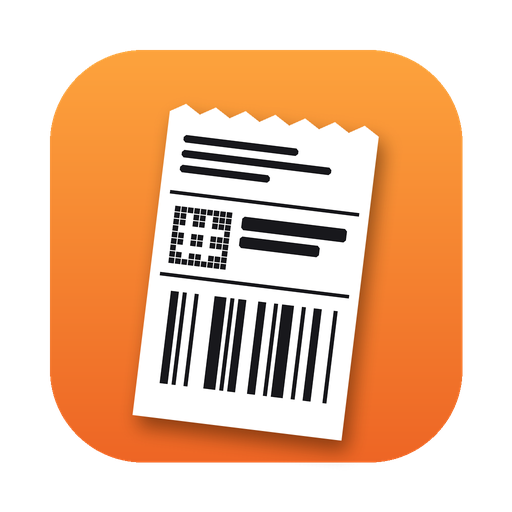

<p align="center"></p>

# Tearoff: crisp Zebra labels from any Mac app

Tearoff is a native macOS printer driver and app for Zebra ZPL label printers (GX420d, GK420d, ZD420/421, ZP 450/500…).
Print a shipping label from **any** app with ⌘P and get a full-size, upright 4×6 label with every barcode
snapped to the printer's dot grid. That includes labels sitting on a letter-size web page, labels lying on their side, and two labels per sheet.

<p align="center"></p>

## What it does

- **A real macOS printer driver.** Your Zebra shows up in every Print dialog. Tearoff's CUPS filter finds the
  label on whatever an app prints and sends it as one compressed ZPL graphic. The label comes out in one pass, with no pausing mid-label.
- **Finds the label for you.**
  - **Embedded images** (UPS/FedEx/Amazon returns) are read at their *native* resolution straight from the PDF.
    This holds even when the browser squashed them, as Firefox does.
  - **Vector labels**, framed or unframed, with solid or dashed cut lines, upright or sideways, are cut out of the page.
    Tearoff never needs a separate image for them.
  - **Two-up sheets** become two labels. **4×6 pages** print 1:1. Pages a browser shrank onto 4×6 paper are scaled back up from the original vector or image data, so nothing goes soft.
- **Turns labels upright** by reading the Code 128 start/stop patterns. This works for raster labels with no text layer.
- **Grid-fit barcodes.** Every Code 128 symbol is decoded and its checksum verified, then redrawn so each bar and space is a
  whole number of printer dots (e.g. 16-mil modules → exactly 3 dots at 203 dpi). A barcode whose checksum doesn't verify is
  never redrawn.
- **Drop a PDF on the app** to preview exactly what the printer will get, dot for dot, then press Return to print.
- **Watch Downloads**: a new label PDF pops a notification with a Print button, or prints automatically.
- **Printer tools**: LAN discovery (port 9100 + the printer's web page; nothing that could print is ever sent to an
  unknown device), live status (paper out, head open, paused), test label, calibrate, darkness, speed, offsets.
- **`tearoff` command** for scripts: `tearoff print label.pdf`.

| | Tearoff | CrispDock |
|---|---|---|
| Price | Free, open source | Free tier watermarks every label; Pro $29.99/yr or $79 |
| Driver for ⌘P in any app | ✓ | ✓ |
| Letter-sheet / sideways / two-up labels | ✓ | ✓ |
| Native-resolution embedded images, vector labels without frames | ✓ documented | not described |
| Barcodes redrawn on the dot grid, verified by checksum | ✓ | "mapped to the dot grid" |
| Watch Downloads, auto-print | ✓ | — |
| Command-line tool | ✓ | — |
| Activation / internet check | none | required |

## Install

```bash
curl -fsSL https://raw.githubusercontent.com/au12/Tearoff/main/get.sh | bash
```

Or build from source (Xcode or the Command Line Tools):

```bash
git clone https://github.com/au12/Tearoff && cd Tearoff && ./install.sh
```

Requires macOS 13 or later on Apple Silicon. The installer puts Tearoff in /Applications, links `~/.local/bin/tearoff` and adds
**Print Label with Tearoff** to the PDF ▾ menu of every Print dialog.

## Set up (once)

1. **Printer**: Tearoff looks for Zebras on your network. Click **Use**, or type the IP address. It asks the printer for its
   resolution (203/300/600 dpi). macOS asks once to allow local network access; click Allow.
2. **Print Driver**: click **Install Driver & Add Printer** and enter your password. This adds e.g. "Zebra GX420d" to macOS,
   connected straight to the printer (`socket://IP:9100`). Already have a Zebra queue? **Switch existing printers** keeps its
   name and connection.
3. Optional: **Print Test Label**. If the bars scan, you're set. If labels drift, run **Calibrate** once.

## Print

- **From any app:** ⌘P → choose your Zebra → Print. Leave the paper size at 4 × 6. Tearoff cuts the label out of whatever the app
  lays out, including a letter-size return page. Darkness, speed and label stock are under *Printer Features*.
- **Drop a PDF/image** on the window or the Dock icon, check the preview, press **Print** (⌘P). Double-click a label to see it at printer resolution.
- **Print dialog → PDF ▾ → Print Label with Tearoff** prints immediately through the app.
- **Downloads:** turn on *Automation → Watch Downloads*. Only files containing a shipping barcode count.
- **Terminal:**

  ```bash
  tearoff print return-label.pdf                 # uses the printer chosen in the app
  tearoff print label.pdf --printer 10.0.10.50 --copies 2
  tearoff extract label.pdf --out labels/        # PNGs at printer resolution
  tearoff zpl label.pdf > label.zpl
  tearoff status --printer 10.0.10.50
  tearoff discover
  ```

## How label finding works

For each page, Tearoff:

1. Walks the PDF content stream (Quartz `CGPDFScanner`, including nested forms) to learn where raster images are drawn and
   at what native size, and which way real text reads.
2. Renders the page at ~1600 px and finds thin straight lines, solid or dashed, then the rectangles they form. These are frames and cut lines.
3. Finds 1D barcodes on a high-resolution render (runs of bars that quantize to 1–4 modules on consecutive scanlines). These seed a
   search for *whitespace-bounded blocks*: every rectangle you can get by cutting the page through empty channels. That isolates
   unframed labels, including two side by side.
4. Scores label-shaped candidates (images, frames, blocks, the page itself) by aspect ratio, barcodes inside and how explicit their
   boundary is. A region that two complete labels tile is split.
5. Orients each label from the Code 128 reading direction (or the PDF's text direction), renders it upright at 3× and area-averages
   down to the printer's dots. Embedded images are read 1:1 from their own pixels. Then it thresholds at 50% coverage and grid-fits
   verified Code 128 symbols.
6. Encodes the label as a single `^GFA` field using Zebra's compressed ASCII. That's about 35 KB per 4×6 label instead of about 250 KB.

All of this is pure Swift in `Sources/TearoffCore`, with no Vision or other ML. The same code runs in the app, the CLI and the
sandboxed CUPS filter.

## Troubleshooting

- **"Couldn't connect"**: check the IP on the printer's configuration label (Printer → Configuration Label, or hold
  FEED on the printer). On macOS 15+, allow Tearoff under System Settings → Privacy & Security → Local Network.
- **Garbled text instead of a label**: the printer is in EPL-only mode. Switch it to ZPL (or auto) in its web page or with
  Zebra Setup Utilities.
- **Labels creep or skip**: run **Calibrate**, or set the label stock under Printer.
- **Too light or heavy**: adjust Darkness (Printer pane or Printer Features in the Print dialog), or Line Weight.
- **Driver logs**: `grep -i tearoff /var/log/cups/error_log` (enable with `cupsctl --debug-logging`).

## Uninstall

```bash
curl -fsSL https://raw.githubusercontent.com/au12/Tearoff/main/uninstall.sh | bash
```

## Development

```bash
swift test                                    # core unit tests
./build.sh                                    # → build/Tearoff.app
python3 tests/make_fixtures.py                # synthetic label PDFs (fake names and tracking numbers)
python3 tests/verify.py build/Tearoff.app/Contents/Helpers/tearoff tests/fixtures out
bash tests/cups_e2e.sh build/Tearoff.app      # real CUPS + driver + fake Zebra on :9100 (needs sudo)
```

CI (`.github/workflows/build.yml`) runs on Apple Silicon: unit tests, every fixture through the extractor (each expected
barcode must scan upright from the 203 dpi output), the full macOS print path (`lp` → Tearoff filter → fake Zebra → ZPL decoded and
scanned), screenshots, and a rolling `latest` release used by `get.sh`.

Fixtures cover a Firefox-style Amazon/UPS return page with a squashed landscape image, USPS-style framed vector labels, unframed
sideways labels, two-up sheets (framed and not), 4×6 pages (vector and 203 dpi raster), a browser printing a letter page onto 4×6
paper, multi-page PDFs and a label-shaped photo that must be ignored.

Tearoff is not affiliated with Zebra Technologies.
